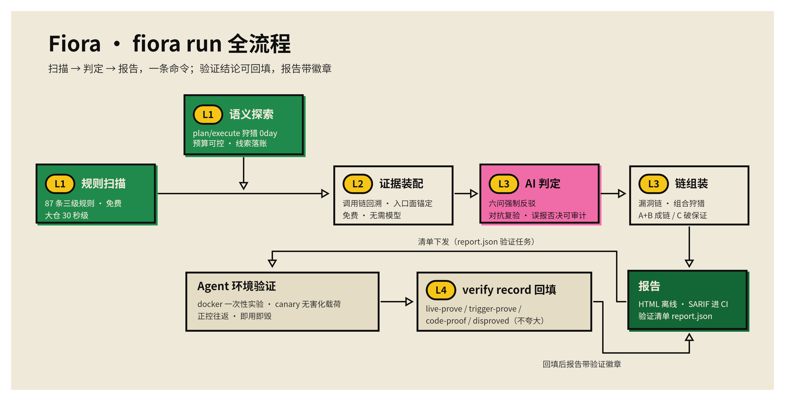
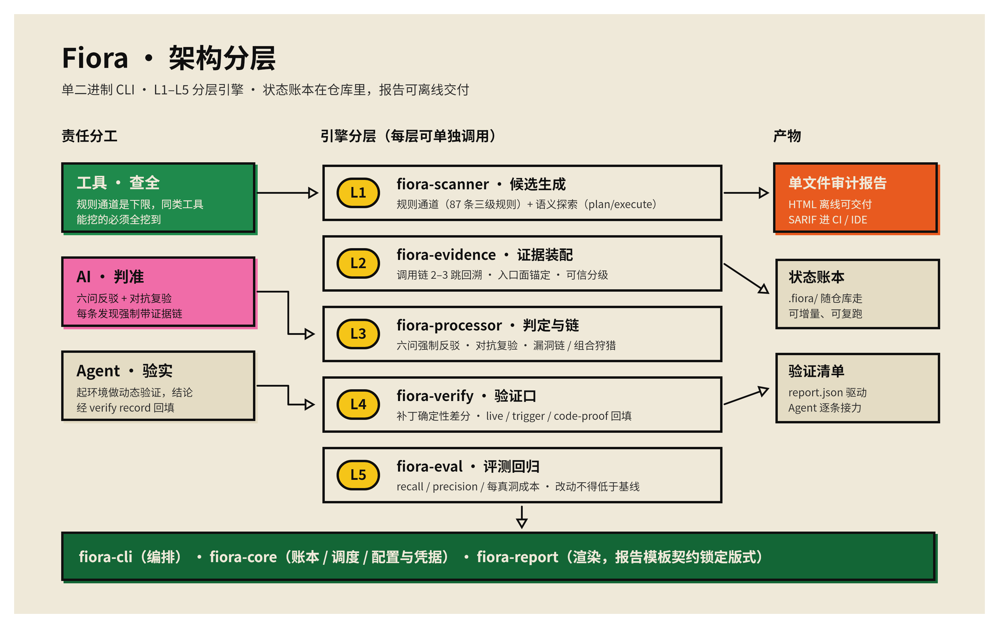

# Fiora

**证据挂载式 AI 代码审计 Harness**。工具负责查全，AI 负责判准。

[](#开发) [](LICENSE) [](#报告长什么样)

单二进制 CLI。规则扫描 + AI 深度判定 + 证据链 + 漏洞链，产出一份**可直接交付的单文件审计报告**（RCE 攻击面置顶、发现↔PoC 双向跳转、自动统计）。

> **产品定位**：fiora 做扫描、判定、报告（纯确定性引擎），是 Agent 工作台背后的代码审计插件。
> 环境验证归 Agent（pi 或其他 coding agent）：起环境验真值，结论经 `fiora verify record` 回填。
> 核心闭环（扫描→判定→报告）不依赖 Agent，`fiora run` 一条命令跑完；SKILL.md 教 Agent 怎么调、怎么验。

## 30 秒了解它

- **三者齐备判定**（sink×source×entry）+ 六问强制反驳 + 证据链逐跳 file:line；
- 每条发现强制带**影响分析 + 触发前置条件 + PoC**（按漏洞类型分派形态）；
- **两轴定级**：危害 × 可达性；部署形态 × 风险面矩阵；
- **诚实三级**：live-prove / trigger-prove / code-proof + 证伪；判定 ≠ 验证，未实测绝不冒充；
- 单二进制，`fiora init` 自举 pi/OpenGrep 双运行时；
- **可进 CI**：`report --sarif out.sarif --fail-on high`，SARIF 2.1.0 导出 + 严重度门禁退出码。
  误报不进结果；同账本导出字节稳定（`partialFingerprints` 保证行号漂移不改身份）。

## 它怎么工作



## 快速开始

**前提**：Node.js ≥22.19（唯一系统依赖，内嵌 Agent 运行时 pi 的硬性要求；`fiora init` 会自动拉取其余运行时）。

### ① 安装二进制（静态链接，解压即用）

```bash
curl -fsSL https://github.com/Ryze-T/fiora/releases/latest/download/fiora-macos-arm64.tar.gz | tar xz
export PATH="$PWD/fiora-macos-arm64:$PATH"   # linux-x64 / linux-arm64 / macos-x64 同理
# 或从源码：cargo build --release && export PATH="$PWD/target/release:$PATH"
# 私有 fork/镜像分发需鉴权下载，用法见 docs/USAGE.md「安装」
```

### ② 首选：交给工作台 Agent 跑

fiora 是 **Agent 工作台背后的审计引擎**。把 [SKILL.md](SKILL.md) 交给你的
coding agent（pi 等），说一句「审计这个仓库」，其余它自己完成：

```
fiora init → fiora run（扫描 + 判定 + 报告）
→ 审报告，按 verificationChecklist 起 docker 环境验真值（canary 无害化）
→ fiora verify record 回填（live-prove / trigger-prove / code-proof / disproved）
→ 交付报告 + 验证徽章 + 验证终表
```

SKILL.md 双章（调用章 + 验证章）是给 Agent 的行为契约：怎么调、怎么验、
验证纪律（canary 无害化 / 正控往返 / 即用即毁 / 不夸大）都在里面。

### ③ 或者：纯 CLI（无 Agent）

```bash
cd <你的仓库>
fiora init --model openai/gpt-5.5 --api-key sk-xxx
fiora run            # 深度永远全量；--severity high|all 调严重度范围（默认 high）
open fiora-report/report.html
```

**10 分钟完整教程 → [docs/TUTORIAL.md](docs/TUTORIAL.md)** · 命令全集 → [docs/USAGE.md](docs/USAGE.md)

> ⭐ 觉得有用就点个 Star，这直接决定我们投入多少精力维护规则语料。踩到规则盲区的话，欢迎用 `fiora draft-rules` 起草规则回馈回来。

## 报告长什么样

完整示例（单文件 HTML，离线可开）：[docs/demo-report.html](docs/demo-report.html)

暗色主题 · 左侧目录 · 自动统计仪表盘 · mermaid 攻击链 · 发现↔PoC 双向跳转 · 一键复制复现包 · 验证徽章三级：

```
执行摘要 → 风险总览仪表盘
→ 一、RCE 风险链路分析（最高优，🔴 直接 RCE / 🟠 升级路径 / ⛓ 利用链）
→ 二、其余风险链路分析（速览表 + 详情卡 + 负向结论可审计）
→ 三、风险复现与 PoC（前置条件 / 步骤 / 预期 vs 实际 / 实测徽章）
→ 四、方法说明与覆盖率（含 部署形态 × 风险面 矩阵）
```

## 核心能力

| 能力 | 命令 | 说明 |
|---|---|---|
| 全量审计 | `fiora run` | 双通道候选（规则 + 语义探索）→ 证据 → 判定 → 链 → 报告；默认只展示高危及以上 |
| 语义深挖（0day 狩猎） | `fiora explore` | 排除已覆盖路径的自我挖掘：plan/execute 分离 + 多轮深挖回路（`--rounds`/`--jobs`），线索落 `.fiora/hunt.md` |
| **组合狩猎** | `fiora compose` | 把单点安全的发现组合成 super-0day（A+B 成链 / C 破保证）；`run` 链组装后自动触发 |
| 确定性补丁差分 | `fiora verify diff` | pre/post 修订 shape 对照：fixed / persisting / regressed |
| **验证结论回填** | `fiora verify record` | Agent 环境验证后写回真值：live / trigger / code-proof / disproved |
| 能力族座次 | `fiora family` | RCE/SSRF/AWF 族聚合 + 可达性档位排序（回答"还有哪些/哪些无条件"）|
| 复现材料起点 | `fiora lab scaffold` | 实验室脚手架（真代码+桩化+canary+正控），Agent 适配后执行 |
| **多模型档位** | `fiora models` / `--profile` | 模型池 + 运行档位：配置多个模型，跑时一键切组合 |
| **项目画像** | `fiora profile` | 模型读仓库提取画像 + 历史 CVE 模式 + 狩猎重点（Agent Native，注入判定/探索）|
| 评测回归 | `fiora eval` | recall / precision / 每真洞成本，改动必须不掉分 |
| 规则资产 | `fiora rules` | 三级规则库（builtin < 用户 < 项目），Semgrep YAML，改数据不重编译 |
| 报告精修 | `fiora enrich / refine / localize` | 补影响+PoC / 短句精炼 / 中文化 |

## 架构



crate 划分：`fiora-cli`（编排）/ `fiora-core`（账本·调度·凭据）/ `fiora-scanner`（L1）/
`fiora-evidence`（L2）/ `fiora-processor`（L3）/ `fiora-verify`（L4）/ `fiora-report`（渲染）/
`fiora-eval`（L5）。扩展点见 [docs/ARCHITECTURE.md](docs/ARCHITECTURE.md)。

## Agent / 二次开发

- **审计轨迹**：`fiora trace <finding-id>` 原生呈现判定全过程（推理/工具调用/结果），轨迹随项目走（`.fiora/sessions/`）；
- **给 Agent 用**：[SKILL.md](SKILL.md)（行为契约、命令决策表、定制点）
- **二次开发**：[docs/ARCHITECTURE.md](docs/ARCHITECTURE.md) 的扩展点表（加规则/换 prompt/换 Agent 运行时/换报告版式）
- **改报告版式**：先改 [docs/REPORT-TEMPLATE.md](docs/REPORT-TEMPLATE.md) 规范，契约测试锁结构

## 开发

```bash
cargo test          # 158 测试（含报告模板契约测试）
cargo clippy --all-targets   # 0 告警门禁
fiora eval --corpus corpus --rule-only   # 下限门禁：规则通道 recall 100%（零模型，可进 CI）
# 全链基线（双冷跑）见 CHANGELOG [0.2.0]：recall 36/36、precision 86%，改动不得低于基线
```

## 使用模式建议

| 模式 | 适用 | 体验 |
|---|---|---|
| **Agent 工作台**（首选） | 完整审计交付、环境验证、攻防演练、组合链验尸 | 读 SKILL.md 全自动：审计 + 起环境验真值 + 回填徽章 |
| **纯 CLI**（无 Agent） | 日常审计、CI 门禁、批量扫描 | `fiora run` 全自动出报告，扫描/判定/报告完整可用 |

## 已知边界（诚实声明）

- **环境验证归 Agent**（产品定位）：fiora 不启动环境、不执行 PoC，验证后 `verify record` 回填（方法论见 SKILL.md 验证章）；
- 所有视图**默认只展示高危及以上**（`--severity all` 显式放开）；低危仍落账；
- pi 是**内嵌执行器**（实现细节）：产品表面全部经由 fiora（含审计轨迹），无需接触执行器；
- 异构栈泛化经验（沙箱/镜像/网络适配公理）沉淀于 ROADMAP.md 攻克记录，供 Agent 起环境时参考；
- 模型协议执行归 pi 运行时，fiora 只做 models.json 路由与凭据注入，细节与 `--api` 覆盖见 docs/USAGE.md；
- **运行时自举带钉值校验**：opengrep 下载按源码内钉死的 SHA-256 逐字节校验
  （官方只发 cosign `.sig/.cert`，强校验可 `cosign verify-blob`）；不符即拒装。
  新版本钉值随升级 PR 登记（`runtime.rs` 的 `OPENGREP_SHA256`）；
- **跨版本账本注意**：0.x 调整过一次 finding 身份推导（含类别归一）。旧账本与新版
  二进制混用重跑会给同一发现生成新 id，追加语义下表现为重复条目；升级大版本
  建议整账本重跑，或等 1.0 的迁移器；
- ARVO 语料导入、分布式 executor 在路线图上。

## License

Apache-2.0
